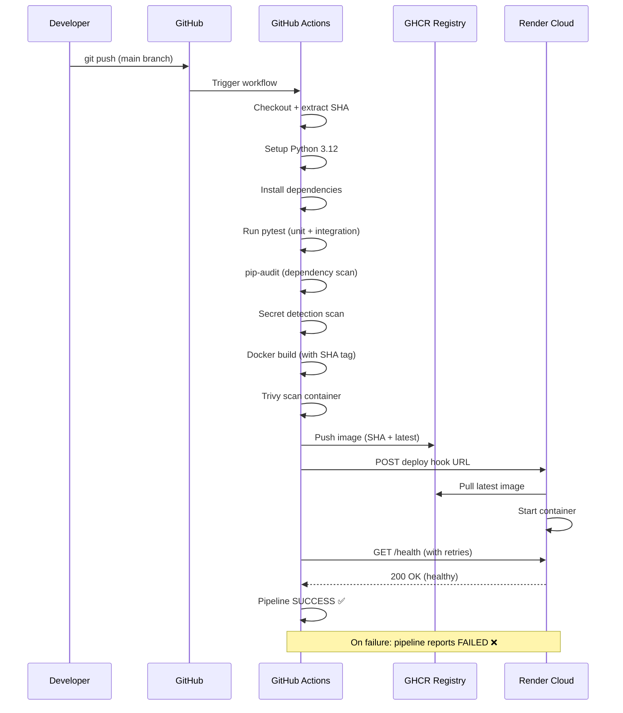
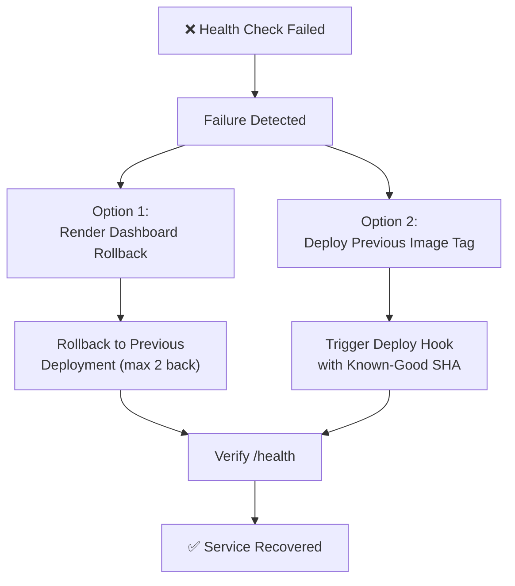
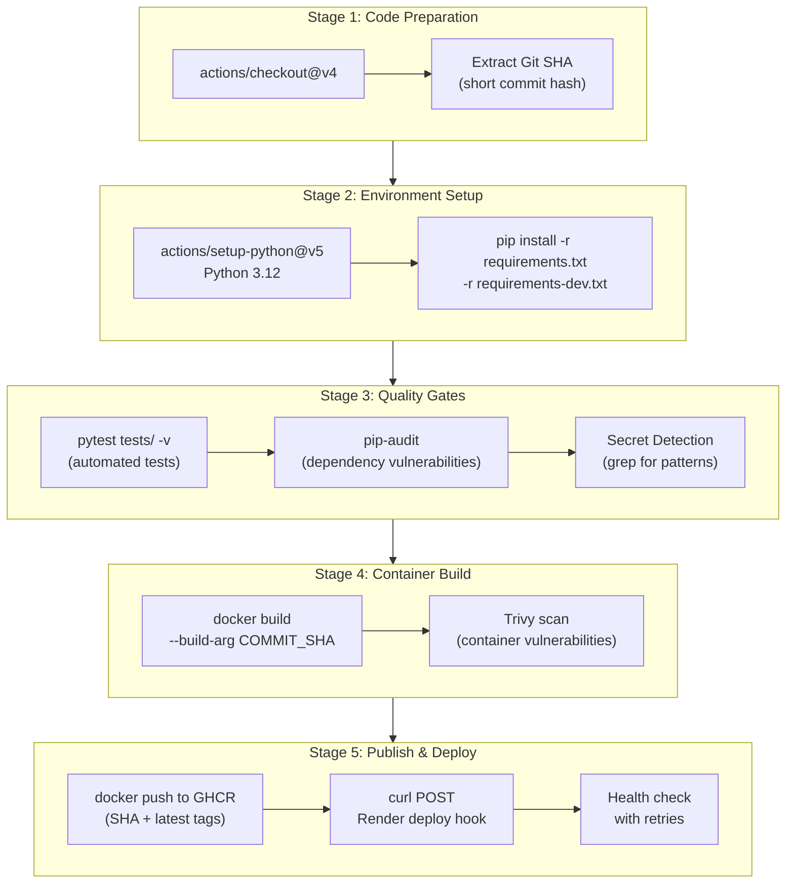

# 🚀 SafeDeploy — Automated CI/CD and Reliable Deployment System

[](https://github.com/Bhargav250804/Safe_Deploy/actions)
[](https://ghcr.io/bhargav250804/safe_deploy)
[](https://python.org)
[](LICENSE)

> **Enterprise DevOps Engineering Platform** — A focused, end-to-end CI/CD pipeline demonstrating automated testing, security scanning, containerised deployment, health verification and rollback capability.

---

## Table of Contents

1. [Project Description](#1-project-description)
2. [Problem Statement](#2-problem-statement)
3. [Objectives](#3-objectives)
4. [Technology Stack](#4-technology-stack)
5. [Architecture Overview](#5-architecture-overview)
6. [Key Features](#6-key-features)
7. [Repository Structure](#7-repository-structure)
8. [Local Setup Prerequisites](#8-local-setup-prerequisites)
9. [Python Environment Setup](#9-python-environment-setup)
10. [Docker Setup](#10-docker-setup)
11. [Running Automated Tests](#11-running-automated-tests)
12. [Building Docker Images](#12-building-docker-images)
13. [Running with Docker Compose](#13-running-with-docker-compose)
14. [GitHub Actions Workflow Explanation](#14-github-actions-workflow-explanation)
15. [GHCR Configuration](#15-ghcr-configuration)
16. [Render Deployment](#16-render-deployment)
17. [Health Check Verification](#17-health-check-verification)
18. [Rollback Instructions](#18-rollback-instructions)
19. [Troubleshooting Guide](#19-troubleshooting-guide)
20. [Security Considerations](#20-security-considerations)
21. [Known Limitations](#21-known-limitations)
22. [License](#22-license)

---

## 1. Project Description

**SafeDeploy** is an automated CI/CD and reliable deployment system built to demonstrate a complete, production-style DevOps pipeline using entirely free-tier tooling. The project implements a lightweight Python/FastAPI microservice with a fully automated pipeline that covers code testing, security scanning, container image building, container registry publishing, cloud deployment, health verification and automated failure detection.

The system is designed to answer a critical DevOps question: *How can a solo developer or small team achieve reliable, repeatable deployments with automated quality gates — using only free tools?*

SafeDeploy is **not** a complex multi-service application. It is intentionally minimal in application logic so that the focus remains on the **DevOps engineering**: the pipeline, the automation, the security, the reliability and the operational discipline.

---

## 2. Problem Statement

### The Deployment Reliability Problem

Manual deployments are error-prone, inconsistent and unauditable. Common problems include:

- **"Works on my machine"** — Code that passes locally but fails in production due to environment differences
- **No quality gates** — Code is deployed without running tests, without security checks, without version tracking
- **No rollback strategy** — When a deployment fails, there is no quick way to revert to the last known-good state
- **No deployment verification** — After deployment, nobody checks whether the service is actually healthy
- **Manual, repetitive steps** — Each deployment requires a developer to remember and execute a series of commands, introducing human error

### What SafeDeploy Addresses

SafeDeploy demonstrates a **zero-trust deployment pipeline** where:
- No code reaches production without passing automated tests
- No container image is published without a security scan
- No deployment is considered successful without a health check
- Every deployment is traceable to a specific Git commit SHA
- Rollback to a previous known-good state is possible

---

## 3. Objectives

| # | Objective | Measured By |
|---|-----------|-------------|
| 1 | Automate the full path from code commit to live deployment | End-to-end GitHub Actions pipeline |
| 2 | Enforce quality gates before deployment | Test pass rate, security scan results |
| 3 | Containerise the application for environment consistency | Docker image builds and runs correctly |
| 4 | Implement security scanning at multiple levels | pip-audit (dependencies) + Trivy (container) |
| 5 | Deploy to a cloud platform automatically | Render deploy hook triggered by CI/CD |
| 6 | Verify deployment health programmatically | Automated `/health` endpoint check post-deploy |
| 7 | Enable rollback on deployment failure | Render dashboard rollback + deploy hook strategy |
| 8 | Trace every deployment to a specific code version | Git SHA embedded in `/version` endpoint |

---

## 4. Technology Stack

| Category | Technology | Version | Purpose |
|----------|-----------|---------|---------|
| **Language** | Python | 3.12 | Application runtime |
| **Framework** | FastAPI | 0.115.6 | HTTP API framework |
| **ASGI Server** | Uvicorn | 0.34.0 | Production-grade ASGI server |
| **Containerisation** | Docker | Latest | Application packaging and isolation |
| **Base Image** | python:3.12-slim | Debian-based | Minimal Python runtime container |
| **CI/CD** | GitHub Actions | v4 | Automated pipeline orchestration |
| **Container Registry** | GHCR | — | Docker image storage and distribution |
| **Security Scanner** | Trivy | Latest | Container vulnerability scanning |
| **Dependency Audit** | pip-audit | Latest | Python dependency vulnerability scanning |
| **Cloud Platform** | Render | Free tier | Application hosting and deployment |
| **Testing** | Pytest | 8.x | Automated test execution |
| **HTTP Client** | HTTPX | 0.28.x | Async test client for FastAPI |
| **Orchestration** | Docker Compose | v2 | Local multi-container development |
| **Shell Scripts** | Bash | — | Build, deploy and verification automation |

---

## 5. Architecture Overview

### System Architecture Diagram

```mermaid
flowchart LR
    DEV["👨‍💻 Developer"] -->|git push| GH["GitHub Repository"]
    GH -->|triggers| GA["GitHub Actions"]
    
    subgraph GA_Pipeline["GitHub Actions Pipeline"]
        direction TB
        CHECKOUT["1. Checkout Code\n+ Extract SHA"] --> SETUP["2. Setup Python 3.12"]
        SETUP --> TEST["3. Run Pytest"]
        TEST --> SEC["4. Security Checks\npip-audit + secrets"]
        SEC --> BUILD["5. Docker Build"]
        BUILD --> TRIVY["6. Trivy Container Scan"]
        TRIVY --> PUSH["7. Push to GHCR"]
        PUSH --> DEPLOY["8. Trigger Render\nDeploy Hook"]
        DEPLOY --> HEALTH["9. Health Verification"]
        HEALTH --> RESULT["10. Pass / Fail"]
    end
    
    GA --> GA_Pipeline
    PUSH -->|image| GHCR["📦 GHCR\nghcr.io/user/safedeploy"]
    DEPLOY -->|HTTP POST| RENDER["☁️ Render\nFree Web Service"]
    GHCR -->|pulls image| RENDER
    RENDER -->|responds| HEALTH
```



### Deployment Flow



### Rollback Flow



---

## 6. Key Features

### CI/CD Pipeline
- ✅ **Automated testing** — Pytest runs on every push to `main`
- ✅ **Multi-layer security scanning** — pip-audit for dependencies, Trivy for container images, grep-based secret detection
- ✅ **Docker containerisation** — Consistent builds using `python:3.12-slim` base image
- ✅ **Container registry publishing** — Images pushed to GHCR with SHA-based tagging
- ✅ **Automated deployment** — Render deploy hook triggered on successful pipeline completion
- ✅ **Health verification** — Post-deployment health check with retry logic

### Application
- ✅ **Health check endpoint** (`GET /health`) — Reports service status and uptime
- ✅ **Version tracking** (`GET /version`) — Returns Git commit SHA and build metadata
- ✅ **Welcome endpoint** (`GET /`) — Service identification and status
- ✅ **Non-root container** — Runs as unprivileged user inside Docker

### Reliability
- ✅ **Rollback capability** — Render supports reverting to previous 2 deployments
- ✅ **Version traceability** — Every deployment linked to specific Git commit
- ✅ **Failure detection** — Health check endpoint enables automated monitoring
- ✅ **Structured logging** — Application logs include timestamps and request metadata

---

## 7. Repository Structure

```
SafeDeploy/
├── 01_FINAL_REPORT/              # Final assessment report (PDF)
├── 02_CODEBASE/                  # All source code and configuration
│   ├── README.md                 # This file
│   ├── .github/
│   │   └── workflows/
│   │       └── ci-cd.yml         # GitHub Actions CI/CD pipeline
│   ├── app/
│   │   ├── __init__.py           # Package initialiser
│   │   └── main.py               # FastAPI application (3 endpoints)
│   ├── tests/
│   │   ├── __init__.py           # Test package initialiser
│   │   └── test_main.py          # Pytest test suite
│   ├── scripts/
│   │   ├── build.sh              # Docker build helper script
│   │   ├── deploy.sh             # Deployment trigger script
│   │   └── health_check.sh       # Health verification script
│   ├── Dockerfile                # Container image definition
│   ├── docker-compose.yml        # Local development orchestration
│   ├── requirements.txt          # Python production dependencies
│   ├── requirements-dev.txt      # Python development dependencies
│   ├── .dockerignore             # Docker build context exclusions
│   └── .gitignore                # Git tracking exclusions
├── 03_EVIDENCE/                  # All testing and deployment evidence
│   ├── architecture/             # Architecture diagrams
│   ├── deployment/               # Deployment results and guides
│   ├── improvements/             # Before/after improvement records
│   ├── logs/                     # Pipeline and deployment logs
│   ├── research/                 # Exploration and research records
│   ├── rollback/                 # Rollback testing results
│   ├── screenshots/              # Visual evidence
│   └── testing/                  # Test results and reports
├── 04_DEMO/                      # Demo instructions and materials
│   ├── DEMO_INSTRUCTIONS.md      # How to demonstrate the project
│   ├── DEMO_SCRIPT.md            # Step-by-step walkthrough
│   └── VIDEO_LINK.txt            # Demo video link
└── 05_DECLARATION/               # Declarations and disclosures
    └── AI_EXTERNAL_TOOLS.md      # AI and tool usage declaration
```

---

## 8. Local Setup Prerequisites

Before setting up the project locally, ensure you have the following installed:

| Tool | Minimum Version | Check Command | Installation |
|------|----------------|---------------|-------------|
| Python | 3.12+ | `python --version` | [python.org](https://python.org) |
| pip | 23.0+ | `pip --version` | Included with Python |
| Docker | 24.0+ | `docker --version` | [docs.docker.com](https://docs.docker.com/get-docker/) |
| Docker Compose | 2.20+ | `docker compose version` | Included with Docker Desktop |
| Git | 2.40+ | `git --version` | [git-scm.com](https://git-scm.com/) |
| curl | Any | `curl --version` | Pre-installed on most systems |

### Optional (for full pipeline testing)
- GitHub account with repository access
- Render account (free tier) — [render.com](https://render.com)

---

## 9. Python Environment Setup

### Step 1: Clone the Repository

```bash
git clone https://github.com/Bhargav250804/Safe_Deploy.git
cd safedeploy
```

### Step 2: Create a Virtual Environment

```bash
# Create virtual environment
python -m venv venv

# Activate (Linux/macOS)
source venv/bin/activate

# Activate (Windows PowerShell)
.\venv\Scripts\Activate.ps1

# Activate (Windows CMD)
.\venv\Scripts\activate.bat
```

### Step 3: Install Dependencies

```bash
# Production dependencies
pip install -r requirements.txt

# Development dependencies (includes pytest, httpx, pip-audit)
pip install -r requirements-dev.txt
```

### Step 4: Run the Application Locally

```bash
# Start the FastAPI server
uvicorn app.main:app --host 0.0.0.0 --port 8000 --reload

# The application is now running at http://localhost:8000
```

### Step 5: Verify Local Endpoints

```bash
# Welcome endpoint
curl http://localhost:8000/

# Health check
curl http://localhost:8000/health

# Version info
curl http://localhost:8000/version
```

Expected responses:

```json
// GET /
{
  "service": "SafeDeploy",
  "status": "running",
  "message": "Automated CI/CD and Reliable Deployment System"
}

// GET /health
{
  "status": "healthy",
  "uptime_seconds": 42.5,
  "timestamp": "2026-11-03T12:00:00Z"
}

// GET /version
{
  "version": "1.0.0",
  "commit_sha": "abc1234",
  "build_date": "2026-11-03T12:00:00Z",
  "python_version": "3.12.x"
}
```

---

## 10. Docker Setup

### Install Docker

If Docker is not installed, follow the official instructions:

- **Windows**: [Docker Desktop for Windows](https://docs.docker.com/desktop/install/windows-install/)
- **macOS**: [Docker Desktop for Mac](https://docs.docker.com/desktop/install/mac-install/)
- **Linux**: [Docker Engine for Linux](https://docs.docker.com/engine/install/)

### Verify Docker Installation

```bash
docker --version
docker compose version
docker run hello-world
```

---

## 11. Running Automated Tests

### Run All Tests

```bash
# From the 02_CODEBASE directory
cd 02_CODEBASE

# Run with verbose output
pytest tests/ -v

# Run with coverage
pytest tests/ -v --tb=short

# Run specific test
pytest tests/test_main.py -v
```

### Expected Test Output

```
========================= test session starts ==========================
platform linux -- Python 3.12.x, pytest-8.x.x, pluggy-1.x.x
collected X items

tests/test_main.py::test_root_endpoint PASSED
tests/test_main.py::test_health_endpoint PASSED
tests/test_main.py::test_version_endpoint PASSED
tests/test_main.py::test_health_status_field PASSED
tests/test_main.py::test_version_has_sha PASSED

========================= X passed in 0.XXs ============================
```

### Test Categories

| Test | What It Validates |
|------|-------------------|
| `test_root_endpoint` | `GET /` returns 200 with service info |
| `test_health_endpoint` | `GET /health` returns 200 with status "healthy" |
| `test_version_endpoint` | `GET /version` returns 200 with version data |
| `test_health_status_field` | Health response contains "status" field |
| `test_version_has_sha` | Version response contains "commit_sha" field |

---

## 12. Building Docker Images

### Build the Image Locally

```bash
# From the 02_CODEBASE directory
cd 02_CODEBASE

# Build with default tag
docker build -t safedeploy:latest .

# Build with specific SHA tag
docker build -t safedeploy:$(git rev-parse --short HEAD) .

# Build with build arguments
docker build \
  --build-arg COMMIT_SHA=$(git rev-parse --short HEAD) \
  --build-arg BUILD_DATE=$(date -u +"%Y-%m-%dT%H:%M:%SZ") \
  -t safedeploy:latest .
```

### Run the Container

```bash
# Run in foreground
docker run -p 8000:8000 safedeploy:latest

# Run in background (detached)
docker run -d -p 8000:8000 --name safedeploy safedeploy:latest

# Check container logs
docker logs safedeploy

# Stop and remove
docker stop safedeploy && docker rm safedeploy
```

### Verify Container

```bash
# Test endpoints
curl http://localhost:8000/
curl http://localhost:8000/health
curl http://localhost:8000/version
```

### Inspect the Image

```bash
# Check image size
docker images safedeploy

# Inspect image layers
docker history safedeploy:latest

# Check image metadata
docker inspect safedeploy:latest
```

---

## 13. Running with Docker Compose

### Start All Services

```bash
cd 02_CODEBASE

# Start in foreground
docker compose up

# Start in background
docker compose up -d

# Rebuild and start
docker compose up --build
```

### Manage Services

```bash
# Check status
docker compose ps

# View logs
docker compose logs -f

# Stop services
docker compose down

# Stop and remove volumes
docker compose down -v
```

### Docker Compose Configuration

The `docker-compose.yml` provides:
- Application service on port 8000
- Automatic restart policy
- Environment variable configuration
- Health check integration

---

## 14. GitHub Actions Workflow Explanation

The CI/CD pipeline is defined in `.github/workflows/ci-cd.yml` and consists of the following stages:

### Pipeline Stage Breakdown



### Detailed Stage Descriptions

#### Stage 1: Checkout & SHA Extraction
```yaml
- uses: actions/checkout@v4
- name: Extract commit SHA
  run: echo "SHORT_SHA=$(echo ${{ github.sha }} | cut -c1-7)" >> $GITHUB_ENV
```
**Purpose**: Checks out the repository code and extracts a short commit SHA for image tagging. This SHA links every deployment to a specific code commit, enabling traceability and rollback.

#### Stage 2: Python Setup
```yaml
- uses: actions/setup-python@v5
  with:
    python-version: '3.12'
- run: pip install -r requirements.txt -r requirements-dev.txt
```
**Purpose**: Installs the exact Python version and all dependencies. Using `setup-python` ensures consistency between local development and CI.

#### Stage 3: Automated Testing (Pytest)
```yaml
- name: Run tests
  run: pytest tests/ -v --tb=short
```
**Purpose**: Runs the full test suite. Tests validate all three endpoints, response codes, response structure and content. **If any test fails, the pipeline stops here** — no code with failing tests will be built or deployed.

#### Stage 4: Security Checks
```yaml
- name: Dependency audit
  run: pip-audit --strict

- name: Secret detection
  run: |
    ! grep -rn "password\|secret\|api_key\|token" --include="*.py" --include="*.yml" app/ || true
```
**Purpose**: Two security checks run in sequence:
1. **pip-audit** scans all Python dependencies for known CVEs in the PyPI advisory database
2. **Secret detection** uses grep patterns to find accidentally committed credentials

#### Stage 5: Docker Build
```yaml
- name: Build Docker image
  run: |
    docker build \
      --build-arg COMMIT_SHA=${{ env.SHORT_SHA }} \
      --build-arg BUILD_DATE=$(date -u +"%Y-%m-%dT%H:%M:%SZ") \
      -t ghcr.io/${{ github.repository_owner }}/safedeploy:${{ env.SHORT_SHA }} \
      -t ghcr.io/${{ github.repository_owner }}/safedeploy:latest .
```
**Purpose**: Builds the Docker image with the commit SHA baked in as a build argument. Two tags are created: one with the specific SHA (for traceability) and one as `latest` (for Render to pull).

#### Stage 6: Trivy Container Scan
```yaml
- name: Trivy vulnerability scan
  uses: aquasecurity/trivy-action@master
  with:
    image-ref: ghcr.io/${{ github.repository_owner }}/safedeploy:${{ env.SHORT_SHA }}
    format: 'table'
    exit-code: '1'
    severity: 'CRITICAL'
```
**Purpose**: Scans the built container image for OS-level and application-level vulnerabilities. The pipeline **fails on CRITICAL vulnerabilities**, preventing deployment of known-vulnerable containers.

#### Stage 7: GHCR Publish
```yaml
- name: Login to GHCR
  uses: docker/login-action@v3
  with:
    registry: ghcr.io
    username: ${{ github.actor }}
    password: ${{ secrets.GITHUB_TOKEN }}

- name: Push to GHCR
  run: |
    docker push ghcr.io/${{ github.repository_owner }}/safedeploy:${{ env.SHORT_SHA }}
    docker push ghcr.io/${{ github.repository_owner }}/safedeploy:latest
```
**Purpose**: Authenticates to GitHub Container Registry using the built-in `GITHUB_TOKEN` (no additional secrets needed) and pushes both image tags. The SHA-tagged image is immutable and can be used for rollback.

#### Stage 8: Render Deployment
```yaml
- name: Trigger Render deploy
  run: curl -X POST "${{ secrets.RENDER_DEPLOY_HOOK_URL }}"
```
**Purpose**: Triggers Render's deploy hook via HTTP POST. Render will pull the `:latest` image from GHCR and redeploy the service. The deploy hook URL is stored as a GitHub Secret to prevent exposure.

#### Stage 9: Health Verification
```yaml
- name: Verify deployment health
  run: |
    for i in $(seq 1 10); do
      STATUS=$(curl -s -o /dev/null -w "%{http_code}" "${{ secrets.RENDER_URL }}/health" || true)
      if [ "$STATUS" = "200" ]; then
        echo "✅ Health check passed"
        exit 0
      fi
      echo "⏳ Attempt $i/10 - Status: $STATUS"
      sleep 30
    done
    echo "❌ Health check failed after 10 attempts"
    exit 1
```
**Purpose**: After triggering deployment, the pipeline waits and checks the `/health` endpoint up to 10 times with 30-second intervals (total 5 minutes). This accounts for Render's cold start time on the free tier. The pipeline only succeeds if the health check returns HTTP 200.

#### Stage 10: Failure Handling
If any stage fails, GitHub Actions:
- Marks the workflow run as **failed** ❌
- Sends notification (if configured)
- Prevents subsequent stages from running
- Preserves logs for debugging

---

## 15. GHCR Configuration

### What is GHCR?

GitHub Container Registry (GHCR) is a container image registry built into GitHub. It allows you to store Docker images alongside your code repository.

### Setup Steps

#### 1. Enable GHCR for Your Account

GHCR is enabled by default for all GitHub accounts. No additional setup is needed.

#### 2. Authentication

The CI/CD pipeline uses `GITHUB_TOKEN` which is automatically provided by GitHub Actions — no manual token creation is required.

For local testing, create a Personal Access Token (PAT):
```bash
# Login to GHCR locally
echo $GITHUB_PAT | docker login ghcr.io -u Bhargav250804 --password-stdin
```

#### 3. Package Visibility

After the first image push, configure package visibility:

1. Go to your GitHub profile → **Packages**
2. Find `safedeploy` package
3. Click **Package settings**
4. Under "Danger Zone", change visibility to **Public**

> **Why public?** Render's free tier needs to pull the image without authentication. Setting the GHCR package to public allows Render to pull it directly.

#### 4. Image Tagging Strategy

| Tag | Purpose | Example |
|-----|---------|---------|
| `latest` | Most recent build from main | `ghcr.io/user/safedeploy:latest` |
| `<sha>` | Specific commit build | `ghcr.io/user/safedeploy:abc1234` |

---

## 16. Render Deployment

### What is Render?

[Render](https://render.com) is a cloud platform that can deploy Docker containers as web services. The free tier provides:
- 750 hours of running time per month
- Automatic HTTPS
- Custom deploy hooks
- Rolling deployments

### Step-by-Step Deployment

See the detailed guide at [RENDER_SETUP_GUIDE.md](../03_EVIDENCE/deployment/RENDER_SETUP_GUIDE.md).

### Quick Setup Summary

1. Create account at [render.com](https://render.com)
2. Create **New → Web Service**
3. Select **Deploy an existing image from a registry**
4. Enter image URL: `ghcr.io/bhargav250804/safe_deploy:latest`
5. Select **Free** plan
6. Set environment variable: `PORT=8000`
7. Configure health check path: `/health`
8. Click **Create Web Service**
9. Copy the deploy hook URL from **Settings → Deploy Hook**
10. Add `RENDER_DEPLOY_HOOK_URL` as a GitHub repository secret
11. Add `RENDER_URL` (your service's public URL) as a GitHub repository secret

### Free-Tier Behaviour

> ⚠️ **Important**: Free-tier services spin down after 15 minutes of inactivity. The first request after idle will take approximately 30–60 seconds (cold start). This is expected behaviour, not a bug.

---

## 17. Health Check Verification

### Manual Verification Commands

```bash
# Check welcome endpoint
curl -s https://your-app.onrender.com/ | python -m json.tool

# Check health
curl -s https://your-app.onrender.com/health | python -m json.tool

# Check version (verify SHA matches expected commit)
curl -s https://your-app.onrender.com/version | python -m json.tool

# Check HTTP status code only
curl -s -o /dev/null -w "%{http_code}" https://your-app.onrender.com/health

# Full headers + response
curl -v https://your-app.onrender.com/health
```

### Automated Health Check Script

```bash
#!/bin/bash
# scripts/health_check.sh

URL="${1:-http://localhost:8000}"
MAX_RETRIES="${2:-10}"
RETRY_DELAY="${3:-30}"

echo "🔍 Checking health at: $URL/health"

for i in $(seq 1 $MAX_RETRIES); do
    STATUS=$(curl -s -o /dev/null -w "%{http_code}" "$URL/health" 2>/dev/null || echo "000")
    
    if [ "$STATUS" = "200" ]; then
        echo "✅ Health check PASSED (attempt $i/$MAX_RETRIES)"
        BODY=$(curl -s "$URL/health")
        echo "   Response: $BODY"
        
        # Also verify version
        VERSION=$(curl -s "$URL/version")
        echo "   Version:  $VERSION"
        exit 0
    fi
    
    echo "⏳ Attempt $i/$MAX_RETRIES — HTTP $STATUS (retrying in ${RETRY_DELAY}s)"
    sleep $RETRY_DELAY
done

echo "❌ Health check FAILED after $MAX_RETRIES attempts"
exit 1
```

### What to Verify

| Check | Expected | Action if Failed |
|-------|----------|-----------------|
| `GET /health` returns 200 | `{"status": "healthy", ...}` | Check container logs |
| `GET /version` returns correct SHA | SHA matches latest commit | Check if correct image was deployed |
| Response time < 5s | Under 5 seconds (after warm-up) | Check application performance |
| Uptime counter increasing | `uptime_seconds` grows | Application is stable |

---

## 18. Rollback Instructions

### When to Rollback

- Health check fails after deployment
- Application returns errors (5xx status codes)
- Version endpoint shows unexpected SHA (wrong image deployed)
- Users report broken functionality

### Rollback Method 1: Render Dashboard (Recommended)

1. Go to [Render Dashboard](https://dashboard.render.com)
2. Select your **safedeploy** web service
3. Go to **Events** tab
4. Find the last **successful** deployment
5. Click **Rollback to this deploy**
6. Wait for rollback to complete
7. Verify with `curl https://your-app.onrender.com/health`

> ⚠️ **Free-tier limitation**: Render only keeps the **2 most recent previous deployments** available for rollback.

### Rollback Method 2: Deploy Previous Image Tag

If you know the SHA of a known-good deployment:

```bash
# Trigger deployment of a specific known-good image
# Update Render service to use: ghcr.io/bhargav250804/safe_deploy:<known-good-sha>

# Or trigger deploy hook (which will pull :latest)
# First, retag the known-good image as :latest
docker pull ghcr.io/bhargav250804/safe_deploy:<known-good-sha>
docker tag ghcr.io/bhargav250804/safe_deploy:<known-good-sha> ghcr.io/bhargav250804/safe_deploy:latest
docker push ghcr.io/bhargav250804/safe_deploy:latest

# Then trigger deploy hook
curl -X POST "$RENDER_DEPLOY_HOOK_URL"
```

### Rollback Method 3: Git Revert

For code-level rollback:

```bash
# Revert the problematic commit
git revert <bad-commit-sha>
git push origin main

# This triggers the full CI/CD pipeline with the reverted code
```

### Post-Rollback Verification

After any rollback, always verify:

```bash
# 1. Check health
curl -s https://your-app.onrender.com/health

# 2. Verify version (should show the rolled-back SHA)
curl -s https://your-app.onrender.com/version

# 3. Check welcome endpoint
curl -s https://your-app.onrender.com/
```

---

## 19. Troubleshooting Guide

### Common Issues and Solutions

#### Issue: Application won't start locally

```
ERROR: [Errno 98] Address already in use
```

**Solution**:
```bash
# Find process using port 8000
lsof -i :8000          # Linux/macOS
netstat -ano | findstr 8000  # Windows

# Kill the process or use a different port
uvicorn app.main:app --port 8001
```

#### Issue: Docker build fails

```
ERROR: failed to solve: python:3.12-slim: not found
```

**Solution**:
```bash
# Pull the base image manually
docker pull python:3.12-slim

# Clear Docker cache and rebuild
docker builder prune
docker build --no-cache -t safedeploy:latest .
```

#### Issue: Tests fail with ModuleNotFoundError

```
ModuleNotFoundError: No module named 'app'
```

**Solution**:
```bash
# Ensure you're in the correct directory
cd 02_CODEBASE

# Install in development mode
pip install -e .

# Or set PYTHONPATH
export PYTHONPATH=$PWD:$PYTHONPATH
```

#### Issue: Render deployment shows 503

**Cause**: Free-tier service is spinning up (cold start).

**Solution**: Wait 30–60 seconds and try again. Free services spin down after 15 minutes of inactivity.

#### Issue: GHCR push fails with 403

```
denied: permission_denied: write_package
```

**Solution**:
1. Ensure repository visibility allows package publishing
2. Check that `GITHUB_TOKEN` has `packages: write` permission in workflow
3. Verify the repository name matches the image name

#### Issue: Trivy reports CRITICAL vulnerabilities

**Solution**:
```bash
# Check what vulnerabilities were found
docker run --rm aquasec/trivy image ghcr.io/bhargav250804/safe_deploy:latest

# Update base image
# Change Dockerfile: FROM python:3.12-slim to latest available
docker build --no-cache -t safedeploy:latest .
```

#### Issue: Health check times out in CI/CD

**Cause**: Render free-tier cold start takes longer than expected.

**Solution**: Increase retry count and delay in the health check step. Current configuration allows up to 5 minutes (10 retries × 30 seconds).

---

## 20. Security Considerations

### Security Measures Implemented

| Layer | Measure | Tool/Method |
|-------|---------|-------------|
| **Dependencies** | Vulnerability scanning | pip-audit with `--strict` flag |
| **Secrets** | Pattern-based detection | grep for sensitive patterns in code |
| **Container** | Vulnerability scanning | Trivy scan on built images |
| **Container** | Non-root execution | `USER appuser` in Dockerfile |
| **Container** | Minimal base image | `python:3.12-slim` (reduced attack surface) |
| **CI/CD** | Secret management | GitHub Secrets for sensitive values |
| **CI/CD** | Least-privilege tokens | `GITHUB_TOKEN` with minimal permissions |
| **Code** | Input validation | FastAPI automatic request validation |
| **Code** | Error handling | Exception handlers prevent info leakage |
| **Repository** | `.gitignore` | Prevents committing sensitive files |
| **Repository** | `.dockerignore` | Prevents copying secrets into images |

### Security Scanning Policy

| Severity | Policy |
|----------|--------|
| **CRITICAL** | ❌ Pipeline blocked — must be fixed before deployment |
| **HIGH** | ⚠️ Reviewed — documented if not immediately fixable |
| **MEDIUM** | 📝 Documented — tracked for future remediation |
| **LOW** | 📝 Documented — accepted risk with documentation |

### What is NOT Covered (Acknowledged Limitations)

- No runtime application security scanning (DAST)
- No SAST (Static Application Security Testing) tool beyond pattern grep
- No network-level security (WAF, DDoS protection) — Render provides basic protection
- No secrets rotation mechanism
- No container image signing
- No SBOM (Software Bill of Materials) generation

---

## 21. Known Limitations

### Render Free-Tier Limitations

| Limitation | Impact | Mitigation |
|-----------|--------|------------|
| **Spins down after 15 min idle** | First request after idle takes ~30-60s | Health check script has retry logic |
| **~1 minute cold start** | Users experience delay on first request | Document in user-facing materials |
| **Ephemeral filesystem** | No persistent data storage on disk | Application is stateless; no disk writes needed |
| **No persistent disks** | Cannot store logs or data on free tier | Logs go to stdout (captured by Render) |
| **Single instance only** | No horizontal scaling | Acceptable for assessment scope |
| **Limited monthly hours** | ~750 hours per month | Sufficient for demonstration |
| **Rollback limited to 2 previous** | Cannot roll back more than 2 deployments | Maintain SHA-tagged images in GHCR |
| **No custom domains (free)** | Uses `*.onrender.com` subdomain | Acceptable for assessment scope |
| **Shared infrastructure** | Variable performance | Not a production deployment |

### Pipeline Limitations

| Limitation | Impact | Mitigation |
|-----------|--------|------------|
| **Single environment** | No staging/production separation | Out of scope for assessment |
| **No parallel jobs** | Pipeline runs sequentially | Keeps pipeline simple and debuggable |
| **Secret detection is basic** | grep-based, not a full SAST tool | Demonstrates the principle; production would use Gitleaks or similar |
| **No canary/blue-green deployment** | All-or-nothing deployment | Render free tier doesn't support advanced patterns |

### Application Limitations

| Limitation | Impact | Mitigation |
|-----------|--------|------------|
| **No database** | No persistent data | Application is stateless by design |
| **No authentication** | Endpoints are public | Acceptable for health check / version endpoints |
| **Minimal business logic** | Not a real-world application | Focus is on DevOps pipeline, not application features |

---

## 22. License

This project is open-sourced under the MIT License.

---

<div align="center">

**SafeDeploy** — *Automated CI/CD and Reliable Deployment System*

Continuous GitOps Delivery & Cloud Reliability Engine

</div>
